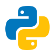
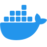

# Ladialma
### Modern Web Development for Growing Businesses

**Web Applications · Custom Development · Digital Solutions**

---

## Who We Are

**Ladialma** is a web development studio focused on building modern, reliable, and scalable web applications for small and medium-sized businesses.

We believe businesses deserve thoughtfully engineered digital solutions that support their operations, improve customer experiences, and adapt as their needs evolve.

Our approach combines modern web technologies, practical software engineering, and purposeful design to create applications that are functional, maintainable, and built with long-term growth in mind.

## What We Do

### Custom Web Applications
We develop web-based applications tailored to the specific needs of each business, from customer-facing platforms to internal management tools.

### Business & eCommerce Solutions
We build digital storefronts, customer portals, and business systems designed to simplify workflows, connect services, and support everyday operations.

### Responsive Web Design
We create modern, accessible interfaces that work across desktops, tablets, and mobile devices, with an emphasis on usability and consistency.

### API & Systems Integration
We connect applications with external platforms, services, and business tools to improve automation, data consistency, and operational efficiency.

### Application Modernization
We help businesses improve existing web applications through interface redesigns, performance improvements, code modernization, and architectural enhancements.

---

## Our Development Philosophy

At Ladialma, we approach software development with a commitment to engineering discipline, transparency, and long-term maintainability.

Our work is guided by five principles:

**01 — Purposeful Design**  
Every interface and feature should address a genuine business or user need.

**02 — Quality Engineering**  
Readable code, thoughtful architecture, testing, and consistent development practices are essential to reliable software.

**03 — Practical Innovation**  
We embrace modern technologies when they provide meaningful improvements, not simply because they are new.

**04 — Collaboration & Transparency**  
Clear communication, defined requirements, and structured reviews help turn ideas into dependable solutions.

**05 — Sustainable Development**  
We build systems that can be maintained, improved, and extended as businesses grow.

---

## How We Work

Our development process follows a structured approach from initial planning through deployment.

We emphasize clear project scopes, iterative progress, documented decisions, and appropriate validation throughout development.

---

## Who We Serve

We focus on small and medium-sized businesses seeking modern digital solutions without unnecessary complexity.

Whether developing a new web application, improving an existing platform, or integrating business systems, our objective is to deliver technology that serves a practical purpose.

---

## Engineering Standards

We maintain documented development conventions to promote consistency, maintainability, and reliable software delivery.

Our standards cover Git workflows, branch conventions, collaborative reviews, release management, and development environment practices.

Explore our [Development Standards](https://github.com/Ladialma/development-standards) repository.

---

## Languages & Technologies

### Front-End
 
 

### Back-End
 

### Database & Hosting

### APIs

### General Tools

### Favorite IDEs

### Events Attended

---

### Ladialma — Built with Purpose. Engineered for Growth.

*Modern web solutions for businesses ready to move forward.*
